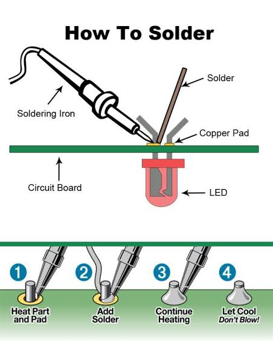
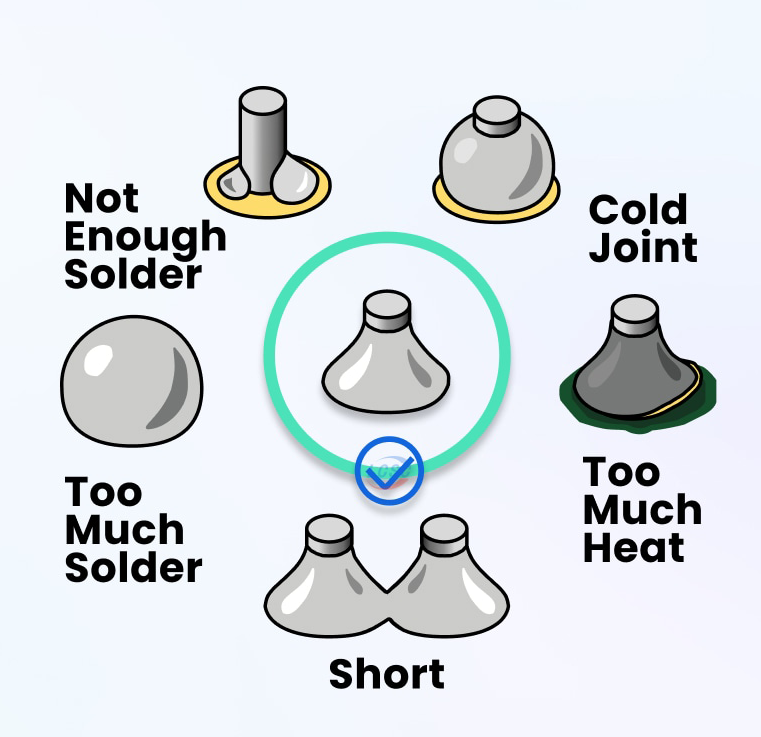
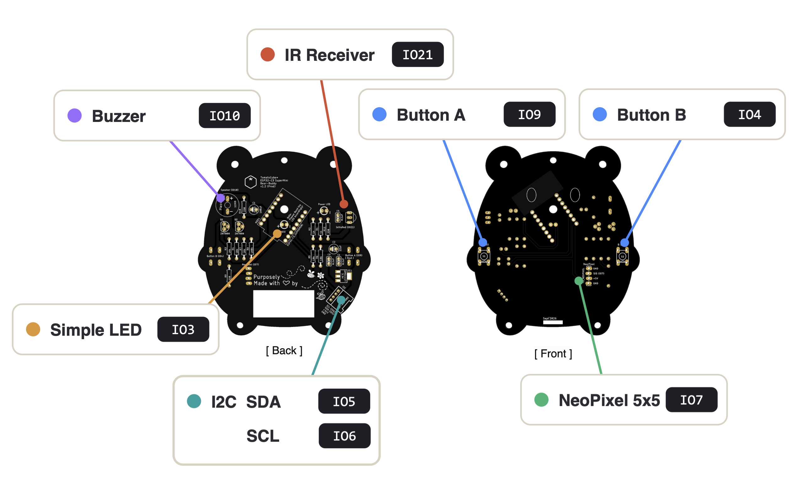

## 🐻 ESP32-C3 Bear-Buddy D.I.Y Desktop Companion -  Quick Start Guide


Last Updated: 2nd Nov 2026

Welcome to Bear-Buddy! This guide takes you from a box of parts and electronics components to a working, programmable electronic desktop gizmo. You will solder & put it together, check it, load firmware onto it from your web browser, and then move on to your first program to give Bear-Buddy a specific purpose (behavior & functionality).

---

## Contents

1. [Why Bear-Buddy?](#1-why-bear-buddy)
2. [What You Need](#2-what-you-need)
3. [Soldering Basics](#3-soldering-basics)
4. [Assembling Bear-Buddy](#4-assembling-bear-buddy)
5. [Checking Your Board](#5-checking-your-board)
6. [Loading Firmware](#6-loading-firmware)
7. [Next Steps](#7-next-steps)
8. [Troubleshooting](#8-troubleshooting)

---

## 1. Why Bear-Buddy?

We created Bear-Buddy to be more than an DIY electronics kit - it is a learning path. One board carries you through the core skills of electronics and moving on to embedded systems MCU programming, one step at a time.

### Hands-on skills

| Skill | What you learn |
|---|---|
| **Soldering** | Handling a soldering iron safely, making clean and reliable joints, reading component markings and polarity |
| **Troubleshooting** | Inspecting joints, using a multimeter, finding shorts and open circuits, thinking like an engineer when something does not work |
| **Assembly (Soldering) planning** | Why the order you solder the electronics parts matters, and how to read a PCB silkscreen |

### A coding pathway that grows with you

Bear-Buddy runs on Espressif's ESP32-C3 chip, a capable 32-bit microcontroller with Wi-Fi and Bluetooth. The same board supports every stage of your coding journey:

```
 MicroBlocks   ──►   CircuitPython   ──►   Arduino / C / C++
 (blocks)      (text, Python intepreter)  (true embedded systems)
```

1. **MicroBlocks - start here.** Drag-and-drop blocks that run live on the board. Change a block and see the result instantly - no compiling, no waiting. Perfect for anyone new learning logic, loops, events and sensors data acquisition.
2. **CircuitPython - graduate to text/line coding.** Real Python code, saved as a file on the board. You learn syntax, libraries, functions and debugging, using a language that is widely used in industry, research and even widely used in A.I.
3. **C / C++ - go advanced.** Using tools like the Arduino IDE or ESP-IDF, you work closer to the hardware: memory, timing, peripherals and performance. This is the language of professional embedded systems.

Because the hardware stays the same, you never have to start over - you simply re-flash the board with new firmware when you are ready for the next level.

---

## 2. What You Need

### In the kit

- Bear-Buddy Production PCB
- ESP32-C3 SuperMini module
- 3D Printed Parts, laser-cut Acrylic & an assortment of screws, nuts & stand-offs
- 5x5 NeoPixel matrix module (with ribbon cable)
- Through-hole components (resistors, LED, tactile switches, connectors, etc.)
- One Surface-mount component - AMS1117 LDO voltage regulator

> Check your parts against the kit's parts list before you start.

### Tools

| Tool | Notes |
|---|---|
| Soldering iron | Temperature-controlled, 40-60 W recommended |
| Solder lead | 0.6-0.8 mm rosin-core wire |
| Soldering iron stand + tip cleaner | Brass wool or a damp sponge |
| Flush/side cutters | For trimming component legs |
| Desoldering wick or pump | For fixing mistakes |
| Multimeter | For checking your board |
| Safety glasses (Optional) | Clipped leads and solder can fly |
| Fume extraction or good ventilation | Do not breathe in the flux smoke |
| USB-C **data** cable | For connecting to your computer |
| Computer with Chrome or Edge | Needed for the web firmware loader |

---

## 3. Soldering Basics

### 3.1 Safety first

- The tip of a soldering iron is around **350 °C**. Always return it to its stand - never lay it on the bench.
- Wear **safety glasses**, especially when trimming leads.
- Work in a **well-ventilated** area or use a fume extractor.
- **Wash your hands** after soldering, and do not eat or drink at your workbench as you are soldering.
- Switch the iron **off** when you take a break or finish.

### 3.2 Setting the temperature

| Solder type | Typical alloy | Recommended iron temperature |
|---|---|---|
| Leaded | 60/40 or 63/37 (tin/lead) | **320 - 350 °C** |
| Lead-free | SAC305 / Sn99.3Cu0.7 | **350 - 380 °C** |

Tips:

- Start at the lower end and increase only if the solder is slow to melt.
- Larger pads and ground connections (connected to big copper areas) soak up heat - they may need a few seconds longer, or 10-20 °C more.
- Too hot burns the flux, oxidises the tip and can lift pads off the PCB. Too cold gives dull, lumpy "cold" joints.

### 3.3 Prepare your tip

1. Let the iron reach temperature.
2. Wipe the tip on brass wool or a damp sponge.
3. **Tin the tip** - melt a small amount of fresh solder onto it so it is shiny. A tinned tip transfers heat much better.
4. Re-tin regularly while working, and before returning the iron to its stand.

### 3.4 Soldering a through-hole joint



1. **Insert** the component leg through the hole, from the silkscreen side. Bend the legs slightly outward on the other side so the part stays in place.
2. **Heat** - touch the tip so it contacts **both** the pad and the leg at the same time. Hold for about 1-2 seconds.
3. **Feed/Add solder** into the joint (the pad and leg, not the iron tip). It should flow around the leg and fill the hole.
4. **Remove the solder** first, then **remove the iron**. The whole joint takes about 3-5 seconds.
5. **Hold still** while the solder cools - do not move the part for a couple of seconds.
6. **Trim** the excess leg just above the joint with flush cutters. Point the leg away from your face (and others!) when cutting.

### 3.5 What a good joint looks like



| Joint | What you see | Fix |
|---|---|---|
| **Good** | Shiny, smooth, cone/volcano shape, pad fully covered | Nothing - well done! |
| **Not enough solder** | Pad or hole not fully covered | Reheat and add a little more solder |
| **Too much solder** | A round ball sitting on the pad | Reheat and remove excess with wick |
| **Cold joint** | Dull, grainy or cracked | Reheat until it flows, add a touch of fresh solder |
| **Short/Solder bridge** | Solder joining two neighbouring pads | Drag the iron between the pads, or use desoldering wick |
| **Too much heat** | Dry (not shiny) and might chip off on contact | Use desoldering wick or pump when solder joint is cooled, and solder again. |

### 3.6 General assembly tips

- **Low to tall** - solder the shortest parts first (resistors), then taller parts (switches, connectors, module). The board will lie flat on the bench while you work.
- **Check polarity** before soldering LEDs & electolytic capacitors, the regulator and connectors. Desoldering a multi-pin part is much harder than placing it correctly.
- **Tack one pin first** on multi-pin parts. Check the part is flat and straight, then solder the rest.
- **Inspect as you go** - do not wait until the end to look for problems.

---

## 4. Assembling Bear-Buddy

### 4.1 Follow the instructor (us) or the animated assembly guide

In the event that you are working through this alone (all by yourself), the step-by-step animated assembly guide shows exactly where each part should go, in the recommended order. You can play it, step through it one part at a time, and change the playback speed:

**👉 [Bear-Buddy v1.2 Animated Assembly Guide](https://tomatocube.com/file_dir/workshop_BearBuddy/Files_v1/Misc/AssemblyGuide/)**

Keep it open beside your workbench and work through the steps in order.

### 4.2 Bear-Buddy specific notes

- **Order matters for the AMS1117 regulator.** Solder the AMS1117 *before* the I2C Grove connector, so you do not scorch the connector's plastic with the iron.
- **Some parts go on the bottom face.** The tactile switches and the NeoPixel matrix connection mount on the **bottom side** of the board - double check placement before soldering them.
- **The NeoPixel matrix ribbon cable is soldered directly** into the board (not plugged into a header). Take care to match the wires to the correct pads.
- **The IO3 LED is bent 90° twice** so its dome shines through the hole to the bottom face. Bend it to shape before soldering, and check its polarity (the longer leg is **+**).

---

## 5. Checking Your Board

Before you plug anything in, spend five minutes checking your work. It can save your board (and your computer's USB port).

### 5.1 Visual inspection

- [ ] Every joint is shiny and cone-shaped
- [ ] No solder bridges between neighbouring pads
- [ ] No missed joints (look at every pad!)
- [ ] All leads trimmed, no loose clippings stuck on the board
- [ ] LEDs, regulator and connectors fitted the right way round

### 5.2 Multimeter checks (power OFF)

Set your multimeter to **continuity** (beep) or **resistance** mode:

| Test | Expected result |
|---|---|
| **5V** to **GND** | No beep (no short) |
| **3V3** to **GND** | No beep (no short) |
| **5v** to **3v3** | No beep (no short) |


If either test beeps, **do not plug the board in**. Look for a solder bridge or a part fitted the wrong way.

### 5.3 First power-up

1. Plug Bear-Buddy into your computer with a USB-C data cable.
2. Watch and sniff: nothing should get hot, smell or magical white smoke. If it does, unplug immediately.
3. Optionally, measure the **3V3** pin to **GND** - you should read about **3.3 V**.

---

## 6. Loading Firmware

Bear-Buddy can run different firmware depending on which language you want to use. You load it straight from your web browser - nothing to download or install.

### 6.1 Requirements

- **Google Chrome** or **Microsoft Edge** on a desktop or laptop (the loader uses Web Serial, which these browsers support)
- A USB-C **data** cable (many cables bundled with power banks only charge)
- Close any other program using the board: the MicroBlocks IDE, Thonny, Arduino IDE or a serial monitor

### 6.2 Put the ESP32-C3 on your Bear-Buddy into bootloader mode

To load new firmware, the ESP32-C3 must be in its **bootloader (download) mode**. On Bear-Buddy, **Button A is the BOOT button**. Use either method:

**Method 1 - Hold while plugging in**
1. Unplug Bear-Buddy.
2. **Press and hold the Boot Button on the ESP32-C3 Module (or Button A of the Bear-Buddy which is also the Boot Button)**.
3. Plug in the USB cable.
4. Release Boot Button or Button A.

**Method 2 - Using the Reset button** (board already plugged in)

1. **Press and hold the Boot Button on the ESP32-C3 Module (or Button A of the Bear-Buddy which is also the Boot Button)**.
2. **Tap the Reset button** on the ESP32-C3 Module once.
3. Release Boot Button or Button A.

The board is now waiting for new firmware. (Nothing will light up - that is normal.)

### 6.3 Flash with the C3 Web Loader

Open the loader:

**👉 [TomatoCube ESP32-C3 Firmware Updater](https://tomatocube.com/file_dir/misc_files/ESP32-C3_Flasher/)**

1. **Which board do you have?** - choose the **5x5 NeoPixel matrix** version (Bear-Buddy).
2. **What should it run?** - choose your firmware:
   - **MicroBlocks** - if you are starting out with block coding
   - **CircuitPython** - if you are ready to write Python code
3. **Flash it**
   - Tick **Erase everything first** when switching between firmware types. *Note: this deletes any programs and files saved on the board.*
   - Press **Flash firmware**.
   - Select your board's serial port in the pop-up and click **Connect**.
4. Wait for the progress bar to reach **100%**.
5. Press the **Reset** button (or unplug and replug) to start the new firmware.

> **Tip:** You can come back to this loader at any time to switch Bear-Buddy between MicroBlocks and CircuitPython.

---

## 7. Next Steps

Now pick the guide that matches the firmware you loaded:

### 🧩 MicroBlocks Getting Started Guide

> **[Bear-Buddy - MicroBlocks Guide](Bear-Buddy_ESP32-C3_MicroBlocks_Mini-Camp.md)** 

Connect to the MicroBlocks IDE, blink the LED, light up the 5x5 NeoPixel matrix and react to button presses - all with blocks.

### 🐍 CircuitPython Getting Started Guide

> **[Bear-Buddy - CircuitPython Guide](Bear-Buddy_ESP32-C3_CircuitPython_Mini-Camp.md)** 

Set up your code editor, write your first `code.py`, and control the LED, buttons and NeoPixel matrix with Python.

### ⚙️ Going further: C / C++

When you are comfortable with CircuitPython, you can program Bear-Buddy in C/C++ using the Arduino IDE (with ESP32 board support) or ESP-IDF. Uploading a C/C++ sketch replaces the current firmware - you can always return to MicroBlocks or CircuitPython with the web loader.

Everything on Bear-Buddy is already wired to a fixed predefined pin on the ESP32-C3, when programming in your choice of C/C++ you just address the right pin in code, and they should all work. Here is the full map Bear-Buddy uses:

| Peripheral                        | ESP32-C3 Pin(s)                     |
| --------------------------------- | ----------------------------------- |
| **Simple LED**                    | `IO3`                               |
| **Button A** (also BOOT / strap)  | `IO9`                               |
| **Button B**                      | `IO4`                               |
| **Buzzer**                        | `IO10`                              |
| **NeoPixel 5×5 Matrix** (serpentine) | `IO7`                            |
| **IR Receiver**      | `IO21`                              |
| **I²C bus** | `SDA = IO5`, `SCL = IO6`           |



> 💡 Note:
> Keep this table handy! This will be the only information you truely need when moving on to advance C/C++ Programming.

---

## 8. Troubleshooting

| Problem | Things to try |
|---|---|
| **No serial port appears in the loader** | Use a USB **data** cable. Unplug, wait 3 seconds, plug back in. On Windows, try a different USB socket. |
| **"Failed to connect" when flashing** | Put the board into bootloader mode by hand (Section 6.2), then press Flash again and choose the port. |
| **Port is busy / access denied** | Close the MicroBlocks IDE, Thonny, Arduino IDE, serial monitors or other browser tabs using the board. |
| **Board gets hot or nothing works after plugging in** | Unplug immediately. Re-check for solder bridges and component polarity (Section 5). Check the AMS1117 orientation. |
| **Some NeoPixels do not light** | Re-check the ribbon cable solder joints and wire order on the matrix connection. |
| **Button does nothing** | Re-check the tactile switch joints on the bottom face. |
| **IO3 LED does not light** | Check its polarity (long leg = +) and its solder joints. |
| **Still stuck after flashing** | In the loader, open **Technical log** and use **Copy log** - share it with your instructor. |

---

*Bear-Buddy QuickStart-Guide - TomatoCube. Happy making!* 🐻
